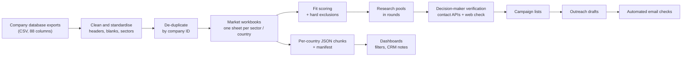

# SME Prospecting Pipeline

A data pipeline that turns raw company-database exports into **scored, verified prospect lists and browsable
dashboards**, for offering a managed-security package to small and medium businesses. It covered Singapore, the US
(Dallas), the Middle East, Europe and the UK. The largest dashboard holds **160,841 companies across 51 countries**.

**Built with:** Python (openpyxl, CSV/JSON processing), HTML/JavaScript dashboards, a serverless function for
CRM notes, company-database exports (Crunchbase), contact-verification APIs (Apollo, Lusha).

---

## How it works

## 1. Cleaning and de-duplication

- **Raw exports:** every column is kept (88), with headers cleaned to plain text. Columns that are entirely blank
  within a sheet are dropped.
- **Cross-dataset de-duplication on company ID.** One export's UK files turned out to be exact copies of the UK
  subset of the EU files. Comparing company IDs proved it, so only one copy was read. Without that, every UK company
  would have been counted twice.
- **The same rule for the same sector:** a new batch of manufacturing companies went through the same
  "ISO-mention" filter as the existing manufacturing sector, so it merged in instead of sitting beside it as an
  uncurated duplicate.

## 2. Fit scoring: "not yet mature, high potential"

The target is a company with real traction but no large security team of its own. Each company is scored with
simple, transparent rules:

| Signal | Points |
|---|---|
| Early-stage funding (pre-seed to Series B) | +4 |
| Mature stage (IPO, private equity, acquired) | −10 |
| Total funding up to $20M / over $100M | +3 / −5 |
| Has a recent funding date | +1 |
| Team size 1–10 / 11–50 / 51–100 / 101–250 | +3 / +4 / +3 / +1 |
| Website listed, founders listed | +1 each |

**Hard exclusions come first:** public companies, acquired or closed companies, non-profits, and investment firms
(VC, PE, funds). For one region the shortlist was instead **researched rather than inferred**: each candidate was
checked for real regulatory exposure and signs of no in-house security team.

Research ran **in rounds** down the ranked list, for example ~900 Singapore FinTech companies in three rounds,
until the whole list was covered.

## 3. Verification before effort

- Decision makers were checked against contact databases that index **current** employment only, and work emails
  were verified before use.
- Later batches were **web-verified before any contact credit was spent** or any copy was written, reversing the
  earlier order after verification caught dead or wrong records.
- Companies removed by verification are kept in an exclusions file **with the evidence**, so nobody adds them back.

## 4. Quality checks on LLM-written outreach

Draft emails were generated per company, so every batch went through automated checks before anyone read it:

- **Per email:** 90–175 words, introduction first, the service named, exactly **one** ask, and none of 11
  **banned constructions**: pivot sentences, claims about the recipient's security, implied incidents, invented
  statistics, stiff openers, guarantees, and more.
- **Across the batch:** no distinctive phrase may appear in more than **3 of 50** emails. The checker counts how many
  *different* emails each word sequence appears in, not how often it occurs overall: *"a phrase used twice in one
  email is a style choice; the same phrase in forty emails is a mail merge."*
- **Shared text is defined once:** the fixed paragraphs live in one place, so claims can't drift between emails, and
  only the company-specific paragraph varies.

## 5. Dashboards at scale

- One HTML dashboard per market, with cascading filters (region, country, sector, sub-sector), sorting with live
  counts, a decision-maker card per company, and CRM notes saved through a small serverless function.
- **160,841 companies in one page:** the data is split into **one JSON file per country** plus a **manifest** with
  the field list and precomputed region / country / sector counts. The page draws its counts and filters from the
  manifest and only loads a country's file when it's opened.

## Data

No data is included in this repository: the company lists, contacts and outreach drafts are private. This page
describes the method only.
