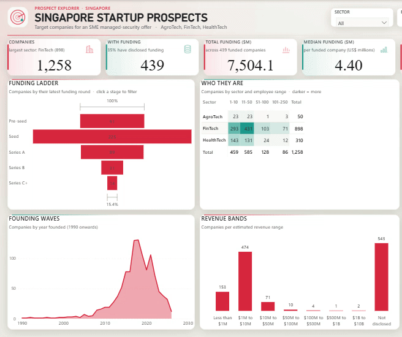

# SME & Startup Prospect Explorer

A data pipeline that turns raw company-database exports into scored prospect lists for a managed-security package
for small and medium businesses, plus **five one-page Power BI prospect explorers**: Singapore 1,258, Malaysia 324,
Dallas 884, EMEA FinTech 13,048 and EMEA SME 154,568 companies.

## What's inside (each explorer)
- **Funding ladder:** a funnel of companies by latest funding round.
- **Sector × company-size heatmap.**
- **Founding waves:** an area chart by year founded.
- **Revenue bands**, or **country bars** in the two EMEA explorers.
- **Target list** with funding bars.
- KPI tiles with live subtitles and slicers in the header. Click any visual to cross-filter the page; hover a
  company to see its card.

## How it's built
- **Clean and de-duplicate.** Exports (88 columns) are cleaned, then de-duplicated on company ID. One export's UK
  files were exact copies of the UK subset of the EU files; the ID check caught it, so no company is counted twice.
  Some companies sit under several sectors, so the EMEA SME explorer holds 154,568 unique companies where the
  original HTML dashboard listed 160,841 rows.
- **Fit scoring.** Hard exclusions first (public, acquired or closed companies, non-profits, investment firms), then
  simple points, for example early-stage funding +4, mature stage −10, team of 11-50 +4.
- **Verify before effort.** Research ran in rounds down the ranked list. Later batches were web-verified before any
  contact credit was spent, and LLM-written outreach was checked automatically (90-175 words, exactly one ask, no
  phrase reused in more than 3 of 50 emails).
- **Power BI.** One CSV per market through a `DataFolder` parameter. Blanks become nulls before typing, and size and
  revenue ranges sort by a hidden order column. The 1920×1080 background artboard and theme are generated in Python.

## Open it
- Open any project in `powerbi/` (for example `powerbi/sme-singapore/SMESingapore.pbip`) in Power BI Desktop, set
  the **DataFolder** parameter, and Refresh.
- No data is included: the company lists, contacts and outreach drafts are private. Contact data and CRM notes are
  left out of the Power BI version.

**Tools:** Python, Power BI (PBIP), Power Query (M), DAX, company-database exports (Crunchbase) · built with Claude
Code as a coding assistant
